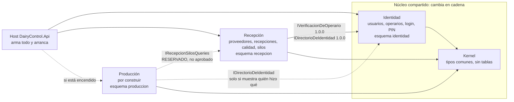

# Módulos de Control Diario Fábrica

_Estado: propuesta para el control 2, 21/10/2026. Responsable: Isaías Muga (líder técnico). Etapa 4 del flujo de Traza: ver `traza-manual/docs/reloj-suizo.md`, sección 4._

Este documento dice cómo se divide el sistema para que Producción se pueda construir como un módulo nuevo, sin pisar a Recepción, conectado solo por contratos. Los contratos escritos como código están en `docs/contratos/` (en inglés, los lee un agente), las decisiones en `docs/adr/` y el orden de trabajo en `docs/plan-migracion-modular.md`.

## 1. En pocas palabras

- Hoy el sistema es **uno solo**: cualquier parte puede leer cualquier tabla. Eso hace que dos personas trabajando a la vez se pisen.
- Lo dividimos en **cuatro piezas**: el **Kernel** (tipos comunes, sin datos), **Identidad** (usuarios, operarios, login y PIN), **Recepción** (proveedores, recepciones de leche, calidad, silos) y **Producción** (todavía no existe).
- Un módulo **nunca lee las tablas de otro**. Si necesita algo, lo pide por un **contrato**. Hoy hacen falta solo **2 contratos de consulta aprobados** (de Recepción a Identidad), además de los tipos del Kernel, y hay **1 reservado** (de Producción a Recepción: la leche de cada silo).
- Los datos de producción **no se tocan ahora**. Primero se acomoda el código (fase A). Recién después de la prueba de adopción del piloto (cerca del 17/11/2026) se mueven las tablas (fase B), cada movimiento en su propio deploy. **Producción nace ya en la estructura nueva**, con su propio esquema, sin mover nada existente.

## 2. Mapa

Flecha llena = aprobada con este documento. Flecha punteada = todavía no existe o no está aprobada.

## 3. Módulos y dueños

| Módulo | Qué contiene | Dueño |
|---|---|---|
| **Kernel** | `ExcepcionDeDominio` y sus categorías, `MotivoDeCambio`, el tipo `CambioRegistrado`, `RolUsuario`, `IUsuarioActual`, `HoraPlanta`, los nombres de las 6 políticas generales, `ContractVersionAttribute`, y los ayudantes de persistencia para módulos con su propia base (`Kernel.Persistence`). Sin tablas | Isaías (líder técnico). Cambios en cadena |
| **Identidad** | `Usuario`, `Operario`, login, tokens y sesiones, PIN y sus bloqueos, cuentas protegidas, su historial; pantallas de login, cambio de contraseña y usuarios | Isaías (líder técnico). Cambios en cadena |
| **Recepción** | `Proveedor`, `RecepcionLeche`, calidad y límites, silos, tickets, `ConfiguracionCalidad`, resumen, listado, carga, corrección y anulación, su historial, datos de demo; pantallas de resumen, recepciones, proveedores, carga rápida y configuración | Isaías |
| **Producción** | Por construir. No se crean proyectos vacíos: nace con la lista de la sección 11 | A definir |
| **Host** (`DairyControl.Api`) | Arma los módulos, `Program.cs`, errores, límite de intentos de login, CORS, salud y arranque | Isaías (líder técnico) |

`CODEOWNERS` asigna por carpeta (ADR 0010). No existe hoy; se crea en el hito E2.

### Contratos reservados (NO aprobados: no se construyen ni se usan)

Están **por encima** de la línea de aprobación a propósito: la regla de la empresa dice que un contrato nuevo solo vale si figura con su versión por debajo de esa línea, y este no debe figurar hasta que lo apruebes.

| Contrato | Lo publicaría | Lo consumiría | Versión | Por qué no está aprobado |
|---|---|---|---|---|
| `IRecepcionSilosQueries` | Recepción | Producción | 0.1.0 (borrador) | Las pantallas de Producción todavía no se diseñaron. Se confirma al terminar sus etapas 2 y 3; ahí pasa a la tabla de arriba con su versión |

**`IRecepcionSilosQueries` funciona igual antes y después de la fase B.** En la fase A la implementación de Recepción lee `dbo.Recepciones` y `dbo.ConfiguracionesCalidad`; en la fase B lee `recepcion.Recepciones` y `recepcion.ConfiguracionesCalidad`. Cambia la implementación, no el contrato (firma, DTO, reglas y tests de contrato). Producción lo puede usar desde el primer día.

## 4. Aprobación

Aprobado (módulos, contratos y grafo): 

_La línea de arriba la completa el líder técnico al aprobar (control 2). Los contratos nuevos valen solo si aparecen con su versión en la tabla de abajo, por debajo de esta línea._

## 5. Quién usa a quién

| Contrato | Lo publica | Lo consumen | Versión | Detalle |
|---|---|---|---|---|
| Kernel (tipos compartidos y ayudantes de persistencia) | Kernel | Identidad, Recepción, Producción, Host | 1.0.0 | `docs/contratos/kernel.md` |
| `IVerificacionDeOperario` | Identidad | Recepción | 1.0.0 | `docs/contratos/identidad.md` |
| `IDirectorioDeIdentidad` | Identidad | Recepción (Producción, si muestra quién hizo qué) | 1.0.0 | `docs/contratos/identidad.md` |

## 6. Matriz de dependencias

Fila = quien usa. Columna = a quién usa. `tipos` = usa los tipos del Kernel. Cada celda con un nombre es un contrato.

| Usa → | Kernel | Identidad | Recepción | Producción |
|---|---|---|---|---|
| **Kernel** | — | — | — | — |
| **Identidad** | tipos | — | — | — |
| **Recepción** | tipos | `IVerificacionDeOperario`, `IDirectorioDeIdentidad` | — | — |
| **Producción** | tipos | `IDirectorioDeIdentidad` (opcional) | `IRecepcionSilosQueries` (reservado) | — |
| **Host** | tipos | registra `AddIdentidad()` | registra `AddRecepcion()` | registra `AddProduccion()` si está encendido |

Lectura de la matriz:
- Identidad y el Kernel no dependen de nadie: pueden cambiar sin avisar a Recepción, mientras no cambien un contrato.
- Recepción depende de una sola cosa de otro módulo: dos contratos de Identidad.
- Producción depende, como mucho, de dos contratos más.
- No hay ciclos.

## 7. Los tres grafos (de dónde salen los cortes)

Se analizó el sistema entero: dominio, servicios, consultas, configuración de base, migraciones, controladores, páginas y servicios del cliente, tests y e2e.

### 7.1 Datos

Cohesión: dentro de Recepción hay la clave foránea de `Recepciones` a `Proveedores`, el join del listado con el nombre del proveedor, el conteo de recepciones por proveedor y dos lecturas de proveedor por corrección; dentro de Identidad, `Usuario` y `Operario` comparten el historial y los intentos de PIN. Entre los dos grupos hay **10 acoplamientos** hoy:

| # | Acoplamiento actual | Qué pasa | Fase |
|---|---|---|---|
| 1 | FK `Recepciones.RegistradoPorUsuarioId`, `Recepciones.OperarioId`, `Recepciones.AnuladaPorUsuarioId` y `Proveedores.CreadoPorUsuarioId` hacia `Usuarios`/`Operarios` | Se borran las 4 FK. Las columnas quedan como `Guid` simples; los nombres se piden con `IDirectorioDeIdentidad` | B (Puente 2). En la A, excepción listada |
| 2 | FK `HistorialCambios.UsuarioId` hacia `Usuarios` | Se borra | B (Puente 2) |
| 3 | Una sola tabla `HistorialCambios` para 4 entidades | Una tabla por módulo (`recepcion.HistorialCambios`, `identidad.HistorialCambios`) | B (Puente 2). En la A, el lector ya se parte por módulo |
| 4 | `RecepcionQueries` lee `Usuarios` y `Operarios` para "quién cargó" | Pasa por `IDirectorioDeIdentidad` | A |
| 5 | `HistorialQueries` lee las 4 tablas y los nombres de autores | Un lector por módulo; autores por contrato | A (lectores), B (tabla) |
| 6 | `ProveedorAppService.RegistrarRecepcionAsync` llama a `VerificacionPinService` | Pasa por `IVerificacionDeOperario`; además el caso de uso se mueve a `RecepcionAppService` (la ruta no cambia) | A |
| 7 | `DemoDataSeeder` usa al primer admin (el primer usuario con rol Admin, ordenado por username; no usa `AdminUser:Username`) | Pide el id con `IDirectorioDeIdentidad.GetIdDelPrimerAdministradorAsync`; el seeder pasa a Recepción | A (id), B (lugar) |
| 8 | El middleware conoce cada excepción | Categorías en el Kernel; el middleware mapea por categoría | A |
| 9 | `CambioRegistrado` valida 4 nombres de entidad fijos y `Campos` mezcla los campos de todos | El Kernel deja de listar nombres; cada módulo tiene sus constantes | A |
| 10 | `Politicas`, `RolUsuario`, `IUsuarioActual` los usa todo el mundo | Van al Kernel (tipos, sin lógica) | A |

Después de la fase A quedan 5 de los 10 como **excepciones listadas** que solo pueden achicarse (1, 2, 3 y la parte de tabla de 5 y la ubicación de 7). Después de la fase B quedan 0.

### 7.2 Reglas

Cada regla vive una sola vez y en un solo módulo: "litros a pagar" (`LitrosAPagarRegla`), "fuera de rango" (`LimitesCalidad.FueraDeRango`), "vigente" (`RecepcionLeche.Vigente`), la regla del silo (`ConfiguracionCalidad.ValidarSilo`) y el ticket único, todas en Recepción. Bloqueo de PIN, bloqueo de login, cuentas protegidas y "nunca menos de un Admin activo", todas en Identidad. La única regla que cruzaba era `ConfiguracionCalidad.SilosMaximo = RecepcionLeche.SiloMax`, que queda dentro de Recepción.

Dentro de Recepción hay tres ajustes de código, sin contrato: `RegistrarRecepcionAsync` se mueve a `RecepcionAppService`; `RecepcionAppService.LeerVersion` y `ProveedorAppService.MensajeTicketDuplicado` (estáticos que usan otros servicios) pasan a un ayudante interno del módulo; `UsuariosDtos.cs` deja de contener DTOs de proveedor y recepción.

### 7.3 Pantallas (cliente)

| Pantalla o pieza | Módulo |
|---|---|
| login, cambiar contraseña, usuarios (con sus tres diálogos), `AuthService`, `UsuariosService`, guards, interceptor de autenticación | Identidad |
| resumen, recepciones, proveedores (lista y detalle), carga rápida, corregir recepción, configuración, inicio del celular de recepción, panel/filtros/lista de recepciones, diálogos de proveedor y observaciones, `calidad.ts`, `diff-recepcion.ts`, `serie-litros.ts` | Recepción |
| `numero-input`, `motivo-dialog`, `historial-dialog`, `numero-es`, `api-error`, `periodos`, estilos comunes | Librería de cliente `@ui` (no es un módulo de backend) |
| barra superior, banner "servidor iniciando" | Shell (host del cliente) |

Aristas cruzadas en el cliente hoy: `AuthService` (lo usa casi todo), `PIN_LENGTH` (lo usa carga rápida), `limits.ts` con constantes de tres áreas mezcladas, `correcciones.ts` con tipos de dos áreas, `motivo-dialog` importando un límite de proveedor, `styles.scss` con selectores por componente y la barra con las pestañas fijas. Se resuelven con `@identidad/publico`, archivos partidos, selectores propios y navegación registrada por módulo (ADR 0009). Hay una pieza sin uso, `confirmar-accion-dialog`, que se borra.

## 8. Dónde vive cada cosa "compartida"

| Cosa | Dónde | Por qué |
|---|---|---|
| Tipo `CambioRegistrado` | Kernel | Es solo forma, sin tabla |
| Tabla y lector de historial | Uno por módulo: `recepcion.HistorialCambios` (Recepción y Proveedor), `identidad.HistorialCambios` (Usuario y Operario), `produccion.HistorialCambios` | Mantiene "el cambio y su historial en el mismo `SaveChanges`" y evita leer tablas de otro. Costo: no hay una tabla única para "todo lo de hoy"; hoy no hay pantalla que la necesite (ADR 0006) |
| Columnas de auditoría de Recepción (`RegistradoPorUsuarioId`, `OperarioId`, `AnuladaPorUsuarioId`, `CreadoPorUsuarioId`) | Recepción, como `Guid` sin FK | Sin claves entre esquemas. La integridad la da la regla "usuarios y operarios no se borran" más un test de contrato (ADR 0006) |
| Nombre de un usuario u operario | Identidad, por `IDirectorioDeIdentidad` | Reemplaza las lecturas directas de sus tablas |
| Verificación de PIN | Identidad, por `IVerificacionDeOperario` | Los contadores de intentos son de Identidad |
| Límites de calidad y cantidad de silos (`ConfiguracionCalidad`) | Recepción (la tabla no cambia de nombre) | Hoy solo Recepción la lee y la escribe. Producción recibe los silos por contrato. **Si Producción necesita editar silos**, nace un módulo Planta (ADR 0007) |
| `HoraPlanta`, `MotivoDeCambio`, `RolUsuario`, `IUsuarioActual`, las 6 políticas | Kernel | Tipos puros que todos necesitan; cambiarlos obliga a avisar a todos, por eso van en cadena |
| Excepciones | Categorías en el Kernel; cada módulo deriva las suyas (`TicketDuplicadoException` a Recepción, `CuentaProtegidaException` a Identidad) | El host no necesita conocer cada excepción |
| Datos de demo y reinicio de demo | Recepción; es el único código que puede borrar filas | Hoy cruza todo |
| Primer admin, cuentas protegidas, ajustes `Jwt`, `Pin`, `AdminUser` | Identidad, como paso de arranque del módulo | Son de usuarios |
| Componentes de pantalla compartidos | Librería de cliente `@ui` | Lo pidió el líder técnico: es del cliente, no un módulo de backend |

## 9. Fases

| | Fase A (ahora) | Fase B (no antes del ~17/11/2026) |
|---|---|---|
| Qué cambia | El código: proyectos por módulo, contratos, Kernel, pruebas de fronteras, cliente partido, andamiaje de módulos | Los datos: Puente 1 (esquemas), un `DbContext` por módulo, Puente 2 (historial partido y FK borradas) |
| Tablas de Identidad y Recepción | Siguen en `dbo`, con un solo `AppDbContext` en un proyecto transitorio | Pasan a `identidad.*` y `recepcion.*` |
| Producción | Nace ya con su esquema, su `DbContext` y su historial | Sin cambios |
| Deploy | Normal. Se revierte redeployando el SHA anterior | Cada movimiento de datos va **solo**, fuera del horario de carga, con aviso a la oficina, ensayo sobre una copia restaurada, backup y rollback escrito |
| Por qué | No se hace cirugía de esquemas sobre producción durante las 4 semanas de prueba de adopción | |

Cosas de la fase A que dependen silenciosamente de la fase B (están en `docs/plan-migracion-modular.md`): las migraciones de Identidad y Recepción siguen en una sola cadena; "sin FK entre esquemas" y "un historial por módulo" no valen para ellos hasta el Puente 2; los interruptores de módulo solo importan para Producción; `Kernel.Persistence` y el spike de SQLite con esquemas son de la fase A porque Producción los necesita desde el principio.

## 10. Lo que se cuestionó del punto de partida

1. **"Núcleo compartido" se parte en dos**: Kernel (tipos, sin datos) e Identidad (módulo con datos y pantallas). Si no, cada cambio de usuarios parece un cambio de los tipos base.
2. **No hay "configuración general"**: la única configuración es `ConfiguracionCalidad` y solo la usa Recepción. Se queda en Recepción; se revisa si Producción necesita editar silos.
3. **Proveedor y Recepción se quedan juntos**: separarlos sumaría unas 6 aristas sin ganar trabajo en paralelo.
4. **El historial no es del núcleo**: cada módulo guarda el suyo, porque el cambio y su historial deben ir en el mismo `SaveChanges`.

## 11. Cómo se agrega un módulo (lista para Producción)

1. `docs/contratos/<modulo>.md` (inglés) y una fila en la tabla de la sección 5 si publica algo; ADR si toma una decisión nueva.
2. Proyectos bajo `src/<Modulo>/`: `Domain`, `Application`, `Infrastructure`, `Api` (y `Contracts` si publica); tests bajo `tests/<Modulo>/`. Agregarlos a `DairyControl.slnx` y al `Dockerfile` (una línea `COPY` por proyecto).
3. Esquema propio, `<Modulo>DbContext` registrado con `AddModuleDbContext<T>(conexion, "<esquema>")`, migraciones propias con su historial en ese esquema, historial de cambios con `MapHistory("<esquema>")`. Sin FK ni lecturas de tablas de otro módulo; a los demás se los referencia por `Guid`.
4. `Add<Modulo>()` y el interruptor `Modules:<Modulo>:Enabled`, **apagado por defecto** en `appsettings.json`; `compose.yaml` y `infra/containerapps/*.yaml` no lo nombran hasta que se encienda en ese ambiente, y el CI corre una variante con el módulo encendido para que su API, su matriz de autorización y su e2e se prueben igual. Las claves de configuración que exige el módulo se declaran para que `ConfiguracionDeArranque` las revise.
5. Excepciones que derivan de una categoría del Kernel; políticas propias declaradas por el módulo; endpoints en la matriz de `AutorizacionTests`.
6. Cliente: carpeta `client/src/app/modulos/<modulo>/` con su `<modulo>.routes.ts`, su navegación registrada y su límite de constantes; importa a otros módulos solo por `@identidad/publico` y `@ui`.
7. e2e en su propia carpeta; `CODEOWNERS` con las líneas del módulo, en el mismo PR.
8. Mergea todos los días a `main` mientras esté apagado.

## 12. Segunda pasada independiente

Un agente nuevo, sin el contexto de esta conversación, intentó romper la división contra el código real. Encontró **3 bloqueantes, 12 importantes y 3 menores**; los 18 se corrigieron o se dejaron decididos en los documentos. Los más importantes:

- **El código de Identidad no compilaba si se movía antes que Recepción** (Recepción usaba el servicio concreto de PIN). Se partió B2 en B2a (contrato), B2b (implementación) y B2c (Recepción pasa a consumir los contratos), todo antes de mover Identidad.
- **B2 mezclaba contrato e implementación**, lo que un issue `[contract]` no permite. Ahora el contrato va solo.
- **`Migrate()` de EF Core falla con cambios pendientes del modelo** y el plan no tenía una guarda. Hay una prueba desde el primer commit de B1, el `AppDbContext` completo sigue corriendo la cadena vieja hasta el Puente 2 y el proyecto Legado nace recién ahí.
- **El deploy deja una revisión vieja atendiendo mientras arranca la nueva**, lo que rompe el corte "corto" de la fase B. Se agregó el paso de sacar de servicio la revisión vieja.
- **Faltaban tipos comunes en el Kernel** (`CorreccionDto`, `MotivoCambioDto`, `ApiErrors`, nombres de claims y de la política de login) y el host referenciaba entrañas de Identidad. Se agregaron y la validación de sesión pasa a `AddIdentidad()`.
- **El contrato del primer admin no reemplazaba lo que hace hoy el seeder** (elige por rol, no por `AdminUser:Username`). Pasó a `GetIdDelPrimerAdministradorAsync`.
- **`Entidad` mide 20 en la columna y el Kernel decía 50.** Queda en 20.
- **Un módulo apagado no se probaba en CI.** Se agregó una variante de CI con el módulo encendido.
- **Las pruebas de arquitectura fijaban un ensamblado de API**, así que los controladores de un módulo nuevo habrían quedado fuera sin aviso. B5 carga todos y cuenta controladores.
- Roles de Producción, archivos que editan todos los módulos, apoyo de tests, cliente (página de inicio por rol, API pública, `tsconfig`), nombres técnicos en inglés y contradicciones entre documentos.

El registro completo, con la evidencia y cómo se resolvió cada uno, está en `docs/reviews/2026-10-21-segunda-pasada-modulos.md`.

## 13. Para decidir al aprobar

- Aprobar las tres filas de la tabla de la sección 5 (el Kernel y los dos contratos de Identidad) y completar la línea de aprobación de la sección 4.
- Confirmar que `IRecepcionSilosQueries` queda reservado hasta diseñar Producción (sección 3, "Contratos reservados").
- Confirmar el endpoint nuevo `GET /api/Modulos` (ADR 0010), que el cliente usa para saber qué módulos están encendidos.
- Confirmar los dueños de la sección 3 (hoy todo es de Isaías).
