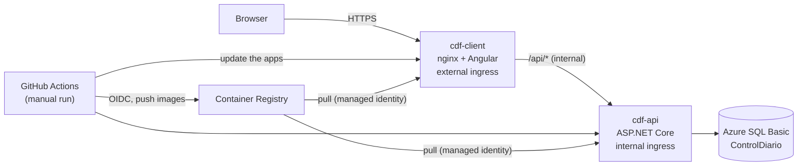

# Production

The production instance of **Control Diario Fábrica** for the plant pilot. It is separate from the demo (which lives in another repository and another Azure resource group), always on, with private images, backups and manual deploys. Everything in Azure is created by one script that you run yourself: [`infra/production.ps1`](../infra/production.ps1).

## What exists

All resources are in the resource group `rg-control-diario-prod`, region **Brazil South**. Nothing touches `rg-dairycontrol` (the demo).

| Resource | Name | Notes |
| --- | --- | --- |
| Azure SQL server | `sql-cdf-prod-<6 hex>` | TLS 1.2 minimum, firewall rule "Azure services", **delete lock** |
| Azure SQL database | `ControlDiario` | Basic (5 DTU, 2 GB), no auto-pause, point-in-time restore for 7 days, **delete lock** |
| Container Registry | `crcontroldiario<6 hex>` | Basic, admin user disabled, private |
| Log Analytics workspace | `log-cdf-prod` | 30 days, daily cap 0.1 GB |
| Container Apps environment | `cae-cdf-prod` | Consumption plan |
| Container app `cdf-api` | internal ingress | 0.25 vCPU / 0.5 GiB, 1 replica always (min 1, max 1) |
| Container app `cdf-client` | external ingress (HTTPS) | nginx + Angular, 0.25 vCPU / 0.5 GiB, 1 replica always |
| Managed identity | `id-cdf-pull` | Role AcrPull on the registry: how both apps pull images (no registry password) |
| App registration | `github-cdf-prod-deploy` | How GitHub Actions logs in (OIDC, no password), see "Credentials" |
| Budget | `bud-cdf-prod` | USD 25 a month, e-mail at 80 % and 100 % of the spend and at 100 % of the forecast |

The API has **no public address**: only the client is reachable from the internet, and nginx forwards `/api` to the API over the environment's internal network.

### Credentials: nothing stored

- **GitHub Actions to Azure:** OIDC. The app registration has a federated credential for this private repository, `main` branch, using the **immutable-ID subject** (`repo:<owner>@<owner id>/<repo>@<repo id>:ref:refs/heads/main`; the script reads both ids with `gh api`; this is what avoids the `AADSTS700213` error, see [deployment.md](deployment.md)). Its roles are the narrowest that work: **Contributor on the two container apps**, **AcrPush on the registry** and **Reader on the resource group**. It cannot remove the locks, so it cannot delete the production database.
- **Accepted risk:** Contributor on a container app can read that app's secrets (`az containerapp secret list --show-values`), and the credential accepts any run of the workflows on `main`. So whoever can merge to `main` can, through a workflow, reach the production secrets. Keep `main` protected (pull request and the required checks) and keep the number of people with write access small; a GitHub *Environment* with required reviewers on the deploy job is the next step if that is not enough.
- **Images:** Actions pushes to the registry with that same identity (no ghcr, no token); the apps pull with the managed identity `id-cdf-pull`.
- **Application secrets:** the SQL password, the JWT signing key and the PIN secret are generated inside the script, sent straight to Container Apps secrets and never printed, logged or written to a file. Only the **bootstrap admin password** is typed by you, without echo.
- **GitHub:** the script sets the repository secrets `AZURE_CLIENT_ID`, `AZURE_TENANT_ID`, `AZURE_SUBSCRIPTION_ID` and the repository variable `ACR_NAME` (they are identifiers, not passwords).

## How to run it (first time with the Azure CLI, on Windows)

You need: an Azure account whose subscription is **pay-as-you-go** (the script stops on a free trial: in the portal go to *Subscriptions*, pick yours and choose *Upgrade*), and admin rights on the GitHub repository.

1. **Install the Azure CLI** if `az version` says the command is not found: open *Windows PowerShell* and run `winget install -e --id Microsoft.AzureCLI`, then close and reopen PowerShell. Check it with `az version`. You also need the GitHub CLI: `gh --version` (install with `winget install -e --id GitHub.cli` if missing).
2. **Log in to both:** `az login` (a browser opens; sign in with the account that owns the subscription) and `gh auth login` (choose GitHub.com, HTTPS, and the browser option).
3. **Choose the subscription:** `az account list --output table` shows them; `az account set --subscription "<name or id>"` selects one. The script shows the one it will use before it does anything.
4. **Open the repository folder** in PowerShell: `cd C:\Users\<you>\Documents\Control-Diario-Planta`. Make sure you are on an up-to-date `main`.
5. **Read what it would do:** `powershell -ExecutionPolicy Bypass -File .\infra\production.ps1 -DryRun`. It runs only read-only commands and prints, in yellow, every command that would create or change something. Nothing is created. Read it; it is the full list.
6. **Run it for real:** `powershell -ExecutionPolicy Bypass -File .\infra\production.ps1`. It asks you to type `SI` to confirm, then asks for the **bootstrap admin password** twice (at least 12 characters; nothing appears on screen). It takes about 10 to 15 minutes. If it fails halfway, read the message and run it again: each step checks what already exists, and nothing that exists is recreated or rotated (an existing API app keeps its secrets).
7. At the end it prints the production address. Until the first deploy it shows a placeholder page, not the app.

Options: `-DeployRoleScope ResourceGroup` (see "If the deploy is refused"), `-BackupRedundancy Local` (if Azure refuses zone-redundant backups in Brazil South for the Basic tier), `-Protegidos "<usernames>"` and `-ActualizarProtegidos` (see "Protected accounts").

The script stops (before creating anything) if the subscription is not **pay-as-you-go**: a free trial, a spending limit, or any other offer (Visual Studio credits, enterprise or partner agreements) is refused on purpose, because the budget and the always-on apps assume pay-as-you-go billing.

The bootstrap admin password may use only letters, digits and `. _ @ # + = -` (at least 12 characters): on Windows the Azure CLI is a `.cmd` file and symbols such as `&`, `%` or `"` can be cut or changed on the way, which would store a different password than the one you typed. It is forced to change at the first login anyway, so choose your real password then.

Do not run the script inside a recorded session (`Start-Transcript`, a screen recorder). It never prints a secret, but while an `az` command runs its arguments are visible to other programs of your Windows user for a few seconds; that is how the Azure CLI takes a secret value.

### What to check afterwards in the portal

Open <https://portal.azure.com> and the resource group `rg-control-diario-prod`.

1. **Resource group:** region Brazil South; nothing else in it than the resources of the table above. *Locks* (left menu) is empty at group level.
2. **SQL server** → *Networking*: "Allow Azure services" is **Yes**, no other rule; *Security*/*Networking* shows minimum TLS version **1.2**; *Locks*: `lock-sql-server`, type *Delete*.
3. **SQL database `ControlDiario`** → *Overview*: Basic, 5 DTU; *Compute + storage*: not serverless (no auto-pause); *Data management* → *Backups* → *Retention policies*: point-in-time restore **7 days**; *Locks*: `lock-sql-db`, type *Delete*.
4. **Container Registry** → *Access keys*: **Admin user disabled**; *Access control (IAM)* → *Role assignments*: `id-cdf-pull` has **AcrPull** and `github-cdf-prod-deploy` has **AcrPush**.
5. **Log Analytics workspace** → *Usage and estimated costs* → *Daily cap*: **On, 0.1 GB**.
6. **Container Apps environment `cae-cdf-prod`**: the logs destination is the workspace above.
7. **Container app `cdf-api`** → *Ingress*: **Limited to Container Apps Environment** (internal), so it has no public address; *Scale*: min 1, max 1; *Secrets*: `db-connection`, `jwt-key`, `pin-secret`, `admin-password` and `protected-usernames` (values hidden, except that `protected-usernames` only holds usernames); *Identity*: user assigned `id-cdf-pull`.
8. **Container app `cdf-client`** → *Ingress*: **Accepting traffic from anywhere**, *Insecure connections*: **not allowed**; *Scale*: min 1, max 1.
9. **App registration `github-cdf-prod-deploy`** (Microsoft Entra ID → App registrations) → *Certificates & secrets*: **no client secrets** and one federated credential `github-main` whose subject starts with `repo:<owner>@<id>/...@<id>:ref:refs/heads/main`; and on the resource group, container apps and registry, *Access control (IAM)* → *Role assignments* shows only: Reader (group), Contributor (each of the two apps), AcrPush (registry).
10. **Cost Management** → *Budgets*: `bud-cdf-prod`, USD 25 a month, with the three alerts to your e-mail. If the script ended with a yellow warning about the budget, it is not there yet: see "If the script stops".
11. **GitHub** → the repository → *Settings* → *Secrets and variables* → *Actions*: secrets `AZURE_CLIENT_ID`, `AZURE_TENANT_ID`, `AZURE_SUBSCRIPTION_ID`; variable `ACR_NAME`.

## If the script stops

The script is safe to run again after any failure: each step checks what already exists and only does what is missing. Read the message, fix the cause, run it again.

| What you see | What it means | What to do |
| --- | --- | --- |
| A yellow **WARNING: the budget alert was NOT created**, with `Unauthorized` / `RBACAccessDenied` in "Azure answered", and at the end `Budget : NOT created` | Azure refused the budget. Right after a subscription is upgraded to pay-as-you-go, **Cost Management can take up to 48 hours** to start working on it, and until then even an Owner is refused. Logging out and in (what Azure's message suggests) does not help. The rest of the setup was finished: the GitHub secrets and the `ACR_NAME` variable are set **before** the budget step, so you can already run *Deploy production*. | Either run the script again a day or two later (it will only create the budget), or create it by hand now: Azure portal → *Resource groups* → `rg-control-diario-prod` → *Cost Management* → *Budgets* → *Add*; name `bud-cdf-prod`, reset period *Monthly*, creation date the 1st of this month, expiration about 5 years ahead, amount **25 USD**; alerts: *Actual* 80 %, *Actual* 100 %, *Forecasted* 100 %, recipient your e-mail; *Create*. If the portal's *Budgets* page itself says the service is not available yet, wait and try again. |
| An authorization error in *Deploy the API* of the workflow | See "If the deploy is refused" below. | Run the script with `-DeployRoleScope ResourceGroup`. |

## Deploy and rollback

**Before the first deploy, expect to verify it.** The deploy updates the apps with `az containerapp update --yaml` (a full template: image, settings and probes). It has not been tried against Azure, and two things can go wrong the first time. (1) If Azure replaces instead of keeping the secrets, the API fails with "secret not found": check *Container app → Secrets*. (2) If the step fails with an authorization error, see "If the deploy is refused". After the first successful run, check in the portal: *Secrets* still lists the five secrets (`db-connection`, `jwt-key`, `pin-secret`, `admin-password`, `protected-usernames`), *Ingress* shows target port **8080** (the workflow sets it in a separate step; if the run stopped between the two, run it again), and *Revisions* shows the new revision healthy with 1 replica.

**Deploy** (the first time and every time): on GitHub open the repository → *Actions* → **Deploy production** → *Run workflow*, branch **main**, leave *sha* empty (it deploys the tip of `main`) and press *Run workflow*. A merge to `main` never deploys. The workflow:

1. only takes commits that are part of `main` and that passed CI;
2. builds `cdf-api` and `cdf-client`, tags them with the short SHA and pushes them to the registry;
3. updates both apps from `infra/containerapps/*.yaml` (image, settings, **probes**) and sets their ingress port to 8080;
4. waits until `https://<address>/health` answers 200 through the client.

**Rollback:** run the same workflow and put the **previous SHA** (the workflow applies the YAML files of *that* commit, so it cannot go back to a commit from before `infra/containerapps/` existed) (shown in the log of the earlier run, or in `git log`) in *sha*. Its images are already in the registry, so nothing is rebuilt. If the bad release ran a database migration, rolling back the code does not undo it: see below.

### Corrections and voids: the migration

The release that adds corrections, voids and proveedor deactivation has a migration (`AgregarCorreccionesAnulacionYBajaDeProveedores`): new nullable columns on `Recepciones` (`AnuladaEn`, `AnuladaPorUsuarioId`, `MotivoAnulacion`) and a row version, `Proveedores.Activo` (default 1: every existing proveedor stays active) and a row version, and the new table `HistorialCambios`. It is backward compatible with the previous release (which inserts without any of these columns), as every migration must be, because the old revision keeps serving while the new one migrates. Nothing is deleted by this change and there is no DELETE endpoint; the production data is only ever corrected, voided or deactivated, each with a reason in the history.

### Protected accounts, reactivation and the history of users: before the first deploy

The release that protects the owner accounts adds one setting to the API, **`AdminUser__Protegidos`** (in the app settings file it is `AdminUser:Protegidos`): the usernames of the owner accounts, **comma-separated** (for example `admin,miusuario`). Another Admin cannot deactivate a protected account, change its role or reset its password (the API answers 403), and the last active Admin can never be deactivated or demoted, by anyone. The flag is set **only** from this setting, at every start of the API; no screen or endpoint can set or clear it. The bootstrap admin (`admin`) is always protected, whatever the setting says. A name in the setting that has no user yet is only logged as a warning at start, and starts working once that user exists and the API restarts.

**The setting reaches the API through a secret, so run the script again before the first deploy of this release** (the deploy applies `infra/containerapps/cdf-api.yaml`, which now reads `AdminUser__Protegidos` from the secret `protected-usernames`; if the secret does not exist the deploy fails and the API does not start):

1. `powershell -ExecutionPolicy Bypass -File .\infra\production.ps1 -DryRun` and read the "Protected accounts" step: on the existing `cdf-api` it must list `az containerapp secret set ... protected-usernames=...` and `az containerapp update ... AdminUser__Protegidos=secretref:protected-usernames`.
2. Run it for real. It asks for the protected usernames, comma-separated (letters, digits and `. _ -`, no spaces inside a name; `admin` is added by itself; leave it empty to protect only `admin`). You can also pass them: `-Protegidos "miusuario,otro.nombre"`. A name the API would not accept stops the script before it changes anything. Nothing else of the app is touched (the other secrets are left as they are).
3. Run it again at any time: an existing secret is left as it is. To **change** the names, run `.\infra\production.ps1 -ActualizarProtegidos` (and give the names); the API reads the new value at its next start, which the next deploy does.

Create the owner's user in the app (Usuarios) **before** the deploy if it does not exist yet, so that the first start already protects it. The release has one migration, `AgregarCuentasProtegidas`: it only adds the column `Usuarios.Protegido` (default 0), so it is backward compatible with the previous release, as every migration must be. The history of users and operarios uses the same table as the history of recepciones (`HistorialCambios`), so it needs no other change; the history of users written before this release does not exist, and each user's history starts with its next change.

### The probes

- `cdf-api`: **startup** and **readiness** on `/health` (200 only when the database answers; the startup probe allows up to 5 minutes because the API migrates the database before it listens), **liveness** on `/health/live` (just "the process answers": a database outage does not restart the API).
- `cdf-client`: all three on `/` (the static page).

### Settings of production

`cdf-api` runs with `Database__ApplyMigrationsOnStartup=true`, `DemoData__SeedOnStartup=false`, `DemoData__ResetOnStartup=false`, `HttpsRedirection__Enabled=false` (TLS ends at the Azure edge), `Proxy__ForwardLimit=2` (the edge plus nginx), `RateLimit__LoginPorMinuto=30`, the four secrets and `AdminUser__Protegidos` (read from the secret `protected-usernames`, see "Protected accounts"). `AdminUser__ForzarCambioPassword` is **not** set: the default is `true`, so the bootstrap admin must choose its own password at the first login. The API refuses to start, and logs every problem as **Critical**, if the connection string, `Jwt:SigningKey` (32 characters or more), `Pin:Secret` (32 or more) or `AdminUser:Password` (8 or more) is missing or too short; a migration or startup failure is logged Critical with the name of the step. Read them in the app's *Monitoring* → *Log stream*, or in the workspace (*Logs*, table `ContainerAppConsoleLogs_CL`).

**Trade-off: migrations at start with one replica.** The API applies pending migrations when it starts. With one replica that is the simplest thing that works, but when a new revision starts the old one keeps serving until the new one is ready, so for a short time both run against the same database. Every migration must therefore be **backward compatible with the previous release** (add columns and tables first, remove things in a later release), and a migration that fails leaves the old revision running and the new one unhealthy. A failed deploy is safe to read about and to roll back from the Actions tab. If this becomes a problem, the alternative is to run migrations from a separate job before the deploy.

### If the deploy is refused

If the workflow step *Deploy the API* fails with an authorization error (`AuthorizationFailed`, "does not have authorization to perform action"), the app-scoped Contributor role is not enough for `az containerapp update --yaml` in your subscription. Run the script again with `.\infra\production.ps1 -DeployRoleScope ResourceGroup`: it gives the GitHub identity Contributor on the whole group (still without the power to remove the locks) and removes the per-app roles. Then run the workflow again.

## Restore drill

Do this once after the first real data is in, and write the result in the table below. It proves that a backup can be restored. The restore creates a **new** database; it never overwrites the production one.

1. **Restore:** Azure portal → the SQL database `ControlDiario` → *Restore*. Choose *Point-in-time*, a time a few minutes ago (UTC), and a new name `ControlDiario-drill`; keep the same server and tier. Press *Review + create*. (Command line: `az sql db restore --resource-group rg-control-diario-prod --server <sql server> --name ControlDiario --dest-name ControlDiario-drill --time "<UTC time, ISO 8601>"`.)
2. **Check the rows:** nobody knows the SQL password (it was generated by the script and only lives in the `db-connection` secret), so use your own Microsoft Entra account: SQL server → *Settings* → *Microsoft Entra ID* → *Set admin* → choose yourself → *Save*. Then open `ControlDiario-drill` → *Query editor*, sign in with *Microsoft Entra authentication* (the portal offers to add your current IP address to the firewall: accept) and run `SELECT COUNT(*) FROM Recepciones; SELECT COUNT(*) FROM Proveedores; SELECT COUNT(*) FROM Usuarios;`. Compare with the same counts in the app (Recepciones, Proveedores, Usuarios). Afterwards remove the temporary firewall rule and, if you do not want it, the Entra admin.
3. **Delete the copy:** the server lock is inherited by every database under it, so first remove it: SQL server → *Locks* → delete `lock-sql-server`. Then delete `ControlDiario-drill`. **Do not delete `ControlDiario`.**
4. **Put the lock back:** run `.\infra\production.ps1` again (it only recreates what is missing: the lock) and check *Locks* again.

| Date | Restored to (UTC) | Counts compared (Recepciones / Proveedores / Usuarios) | Result | Done by |
| --- | --- | --- | --- | --- |
| _pending_ | | | | |

## First-time setup in the app

1. Open the production address and log in as **`admin`** with the bootstrap password you typed. The app forces you to choose a **new password** before anything else (that is `DebeCambiarPassword`); choose a long one and keep it in your password manager. The bootstrap password in the Azure secret `admin-password` is only used to create the first admin while there are no users: it is not a way in afterwards. But the API still **requires the secret to exist (at least 8 characters) at every start**, so do not delete it, and it stays stored there with the password you typed in the script. If the database is ever restored empty, the API would recreate `admin` with that password (forced to change again), so treat it as a secret you can rotate: container app `cdf-api` → *Secrets* → edit `admin-password`, then restart.
2. **Usuarios** → create the real people, each with a temporary password that they must change at their first login:
   - the agronomist: role **Administrador**;
   - the office clerk: role **Administrador** (as agreed for the pilot; the Oficina role exists and is not used yet);
   - the owner: role **Consulta (solo lectura)**.
   Then keep `admin` for emergencies. `admin` and the usernames of `AdminUser__Protegidos` are protected accounts: they cannot be deactivated (so do not plan to deactivate `admin` from the app; if that is ever really needed, remove it from the setting first and restart the API). Deactivating, reactivating and changing the role of any other user asks for a reason and is kept in the history of that user (Usuarios → Historial).
3. **Operarios** (the reception phone): create each operator with a PIN, and a user of role **Celular de recepción** for the phone.
4. **Proveedores**: load the tambos (the real suppliers).
5. **Configuración**: set **Cantidad de silos** to **3** and check the **quality limits** (acidity, temperature, water) against the plant's own numbers; save.
6. Register one test recepción from the reception phone and from an office user, check that it shows up under the right user, and that the owner (Consulta) sees it and has no way to change anything.

There is no demo data: the database starts empty, and a restart never seeds or resets anything.

### Developing locally

Because the bootstrap admin is forced to change its password by default, a local `dotnet run` that logs in with the User Secrets password is asked to change it too. For development set the user secret `AdminUser:ForzarCambioPassword` to `false`. The Docker Compose stack (and so the e2e tests) already sets it to `false`.

## Scaling up when the numbers say so

Start small; look at the metrics in the portal after the first weeks (and after the first busy day), and scale only when they say so.

- **Database:** SQL database → *Monitoring* → *Metrics* → **DTU percentage** (and *Storage percentage*). If DTU stays above about 80 % for hours at a time, or the 2 GB of Basic is close to full, move to S0 (10 DTU, 250 GB): `az sql db update --resource-group rg-control-diario-prod --server <sql server> --name ControlDiario --service-objective S0` or the portal's *Compute + storage*. It takes a few minutes, with a short reconnect.
- **API:** container app `cdf-api` → *Monitoring* → *Metrics* → CPU and memory usage. If they stay near their limit, change `cpu` and `memory` in `infra/containerapps/cdf-api.yaml` from `0.25` / `0.5Gi` to `0.5` / `1.0Gi` and run the deploy workflow.
- Raise the budget in Cost Management when you do (S0 adds about USD 12 a month; 0.5 vCPU / 1 GiB for the API adds about USD 6).

## Monthly cost

USD, list prices of the Azure Retail Prices API for Brazil South, 30 days. Check them in the [Azure pricing calculator](https://azure.microsoft.com/pricing/calculator/) before relying on them; prices change.

| Item | Monthly |
| --- | --- |
| Azure SQL Basic (5 DTU, 2 GB, 7-day point-in-time restore): 0.1948 a day | 5.84 |
| Container Registry Basic: 0.1666 a day | 5.00 |
| Container Apps, 2 apps always on, 0.25 vCPU / 0.5 GiB each (idle 3e-6 per vCPU-second and GiB-second, active 2.4e-5 per vCPU-second, minus the free monthly grant, plus some active time) | about 11 to 12 |
| Log Analytics (cap 0.1 GB a day, about 3 GB a month, inside the 5 GB free grant) | about 0 (at most 13.80 if the free grant does not apply) |
| **Total** | **about 22 to 23** |

The budget alert is USD 25. For reference: S0 instead of Basic adds 11.73; the API at 0.5 vCPU / 1 GiB adds about 6.

## Not done yet (follow-ups)

- **Entra-only authentication for SQL with a managed identity** for the API, so that there is no SQL password at all.
- The pilot runs one replica and applies migrations at start (see the trade-off above).
- Alerts on the application itself (a failed health probe, the restart count) beyond the budget alert.
